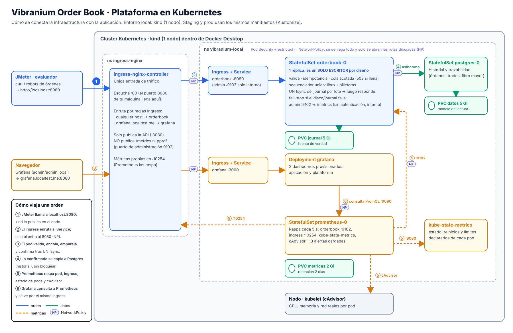

# vibranium-orderbook-infra

Infraestructura como código (Kubernetes + Kustomize) de [`vibranium-orderbook-meli`](https://github.com/AdminMod18/vibranium-orderbook-meli).
**Un solo conjunto de manifiestos** se despliega en varios ambientes (local, staging, prod) cambiando solo lo que de verdad difiere.



## Levantarlo en local (4 comandos)

**Necesitas:** Docker Desktop en marcha, [`kind`](https://kind.sigs.k8s.io/) (Windows: `winget install Kubernetes.kind`, y reabre la terminal) y `kubectl`.
Clona **al lado** el repo de la app (`../vibranium-orderbook-meli`) o define `APP_DIR=<ruta>`. En Windows usa **Git Bash**. Detén antes `docker compose` de la app (usa el mismo puerto 8080).

```bash
scripts/kind-up.sh        # cluster kind + ingress-nginx
scripts/build-image.sh    # construye la imagen de la app y la carga en el cluster
scripts/deploy.sh local   # despliega y espera a que todo esté listo
scripts/smoke.sh          # termina con SMOKE OK (30 comprobaciones)
```

| | |
|---|---|
| API | http://localhost:8080 |
| Grafana (2 dashboards) | http://grafana.localtest.me:8080 (admin/admin en local) |

## Probar qué pasa si algo falla

```bash
scripts/chaos.sh kill-pod         # mata el pod sin apagado ordenado: el estado sobrevive (journal en un volumen)
scripts/chaos.sh postgres-down    # apaga Postgres: el mercado sigue y el historial se reconcilia solo
```

**Carga contra el cluster** (todo el tráfico entra por el ingress), desde el repo de la app:
`HOST=localhost PORT=8080 TPS=5000 jmeter/run-jmeter.sh sostenida`

Borrar todo (**elimina los datos del cluster**): `scripts/kind-down.sh`

## Estructura

| Ruta | Qué es |
|---|---|
| `base/` | Lo común a todos los ambientes: order book, Postgres, Prometheus, Grafana, ingress, NetworkPolicy, dashboards y alertas |
| `overlays/{local,staging,prod}/` | Lo que cambia por ambiente: namespace, imagen, hosts, tamaños (3 archivos pequeños cada uno) |
| `scripts/` | Despliegue, humo, caos, validación estática y utilidades |
| `docs/` | `PLATAFORMA.md` (diseño y limitaciones) y `EVIDENCIA.md` (resultados reales y lo que no se probó) |
| `.github/workflows/ci.yaml` | Valida cada overlay y ejecuta en un kind real el humo y el caos |

Otros ambientes: `scripts/validate.sh` (estático, sin cluster) y `CONFIRM_CONTEXT=<ctx> scripts/deploy.sh staging`. **Añadir un ambiente** = copiar `overlays/staging/` y cambiar namespace, imagen y hosts.

## Si algo no funciona

| Síntoma | Qué hacer |
|---|---|
| `kind: command not found` tras instalarlo | Cierra **por completo** la terminal y ábrela de nuevo (el PATH se carga al abrirla) |
| `solo quedan N GiB libres en el disco` | Libera espacio: una corrida genera varios GiB y, con el disco lleno, Docker se cuelga. Puedes forzar con `MIN_FREE_GB=<n>` bajo tu responsabilidad |
| `docker` o `kubectl` no responden | El motor de Docker se colgó: ciérralo, `wsl --shutdown` (Windows), ábrelo de nuevo. Comprueba el espacio libre en `C:` |
| El puerto 8080 está ocupado | `HTTP_PORT=8081 scripts/kind-up.sh` (y usa ese puerto en las URLs) |
| El CI falla clonando la app | Si el repo de la app es **privado**, crea un token de solo lectura (*Contents: Read-only*) y guárdalo como secreto `APP_REPO_TOKEN` en este repo |

## Estado de la verificación

| Qué | Estado |
|---|---|
| Overlays válidos (kustomize, esquema de Kubernetes 1.31, políticas propias) | ✅ en cada push |
| Despliegue en kind real, humo (30 comprobaciones) y las dos pruebas de caos | ✅ en el CI y en Docker Desktop |
| Caos: crash del pod → estado idéntico, **RTO 4.1 s en CI y 10.7 s en la laptop** (journal casi vacío) | ✅ |
| Carga por el ingress, 10 min: 4.56 M peticiones, **0 % de error**, ~7 000 órdenes/s | ✅ (JMeter GUI, una sola laptop: no es capacidad máxima) |
| Staging y prod | plantillas validadas; **nunca desplegadas** |

Detalle, enlaces a cada ejecución y lo que **no** se probó: [`docs/EVIDENCIA.md`](docs/EVIDENCIA.md).
